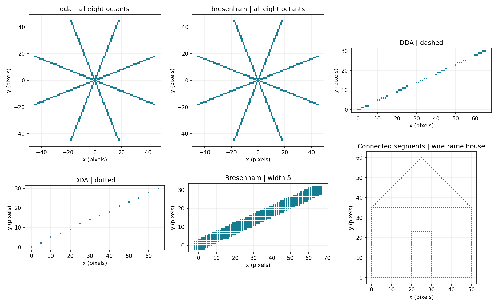
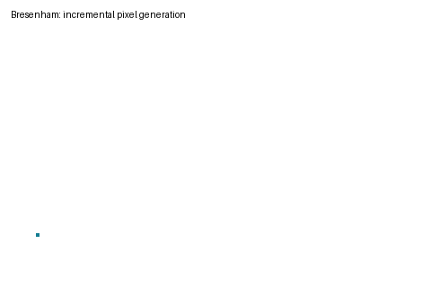

# Lab 1 — DDA and Bresenham line drawing

Run from the repository root: `python -m lab_01.main` (`--show` opens the PNG).

Both algorithms generate the actual integer raster coordinates; Matplotlib only displays them. Endpoints are included, all octants and zero-length lines are supported. DDA uses a maximum-axis step count and floating-point increments. Bresenham maintains an integer error accumulator and steps one or both axes.

## Assignment coverage

| Manual question | Implementation / evidence |
|---|---|
| 1. Dashed DDA | `styled(dda(...), 'dashed')`; six pixels on, four off |
| 2. Dotted lines | `styled(..., 'dotted')`; one pixel per five steps |
| 3. Thick Bresenham | `styled(bresenham(...), width=5)`; square pixel brush |
| 4. Connected segments | `polyline(vertices)` |
| 5. Time 1,000 random lines | `outputs/benchmark.csv`; seed 4104, five measured repetitions |
| 6. Eight octants | Symmetric eight-ray demonstration and exhaustive small-endpoint tests |
| 7. Animation | `outputs/line_animation.gif` |
| 8. Wireframe house | House and door assembled with Bresenham segments |

The timing is measured on the execution environment, includes Python list allocation, and is not a universal hardware performance claim. A thick line uses a square brush, so its perpendicular width varies with slope. Pixel aliasing is intentionally visible.

## Viva answers (manual order)

1. Raster graphics represents images with discrete pixels.
2. Line algorithms select pixels approximating a continuous segment.
3. Scan conversion maps geometric primitives to raster pixels.
4. DDA advances along the dominant axis and rounds the interpolated coordinates.
5. It uses floating-point work and rounding, and incremental implementations may accumulate error.
6. Bresenham uses integer additions and comparisons; actual Python timing is measured in the CSV.
7. The decision/error parameter determines which neighboring pixel better approximates the line.
8. Multiplying the line-distance error removes fractional comparisons.
9. Bresenham is well suited to integer hardware.
10. DDA interpolates floating-point coordinates; Bresenham updates integer error.
11. For slope magnitude above one, y becomes the dominant axis; the implementation handles this directly.
12. Aliasing is the staircase effect caused by sampling a continuous edge on a grid.
13. Pixel resolution is the number of addressable samples across each image dimension.
14. Primitives are basic shapes such as points, lines, triangles, and polygons.
15. Applications include CAD, wireframes, charting, and raster displays.
