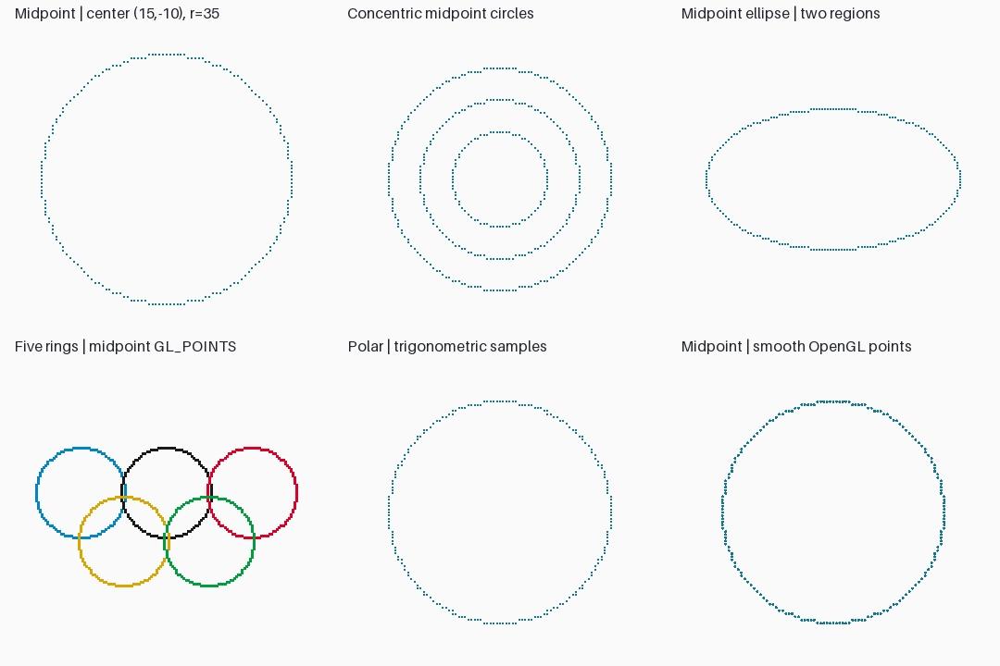
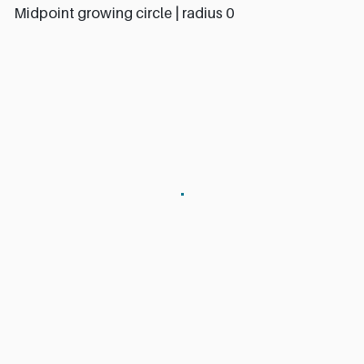

# Lab 2 — Midpoint circle drawing

Run `python -m lab_02.main --center 15 -10 --radius 35` from the root. By default it opens real OpenGL windows; close each to continue. Add `--headless` for Linux EGL export. Integer radius zero is a point; negative radii are rejected.

`midpoint_circle` starts at `(0,r)` with decision value `1-r`, increments x, optionally decrements y, and emits eight symmetric points. Duplicates at axes and diagonals are removed. No circle drawing primitive is used.

| Assignment | Implementation / evidence |
|---|---|
| 1. User center | `--center CX CY` |
| 2. Concentric circles | Three radii in `outputs/circles.png` |
| 3. Midpoint ellipse | `midpoint_ellipse`; separate shallow/steep regions; zero-axis cases handled |
| 4. Growing animation | `outputs/growing_circle.gif` |
| 5. Olympic rings | Five-ring raster arrangement; crossings simply overlap, with no woven over/under effect |
| 6. Polar comparison | `polar_circle` uses approximately one angular sample per pixel of circumference |
| 7. Anti-aliasing | OpenGL high-resolution point raster with 4×4 framebuffer area averaging in `gl_antialias`; CPU `antialiased_circle` retained as a test reference |
| 8. Radius timings | `outputs/benchmark.csv`; 100 runs per radius and algorithm |

The midpoint loop takes O(r) time. This implementation sorts the returned set for deterministic output, adding O(r log r) bookkeeping. Polar evaluation uses trigonometry; compare the measured CSV rather than assuming a fixed speed ratio. Supersampling increases memory and work.

## Viva answers (1–15)

1. Scan conversion chooses raster pixels for geometry.
2. Midpoint avoids evaluating square roots and deciding both positive and negative circle roots at every x.
3. Its decision parameter estimates the circle implicit function at the midpoint between candidate pixels.
4. Eight-way symmetry maps `(x,y)` to sign changes and coordinate swaps around the center.
5. The remaining seven octants follow from that symmetry.
6. Integer recurrence reduces arithmetic cost and fractional rounding.
7. Aliasing creates jagged sampled boundaries; supersampling reduces their appearance.
8. Midpoint and Bresenham circle algorithms both use incremental error tests and symmetry, with differing decision formulations.
9. `1-r` is the integer approximation to the initial midpoint test at `(1,r-1/2)`.
10. Raster graphics stores colors on a discrete grid.
11. A circle recurrence does not directly draw ellipses; the included two-region ellipse algorithm does.
12. OpenGL could display generated points; this implementation submits the generated samples to OpenGL with `GL_POINTS`.
13. The circle-generation loop is O(r), plus output storage; see sorting overhead above.
14. Points, lines, circles, and polygons are graphics primitives.
15. Uses include CAD circles, instrument dials, and raster interface elements.

## OpenGL evidence

`outputs/opengl.json` records the GL vendor, renderer, version, GLSL, backend, and depth-buffer precision. All scene PNGs and animation frames originate in `glReadPixels`; Pillow only encodes images or downsamples the supersampled GL framebuffer. The final panel demonstrates OpenGL point smoothing, and the standalone anti-aliased PNG uses supersampling for explicit coverage averaging.
