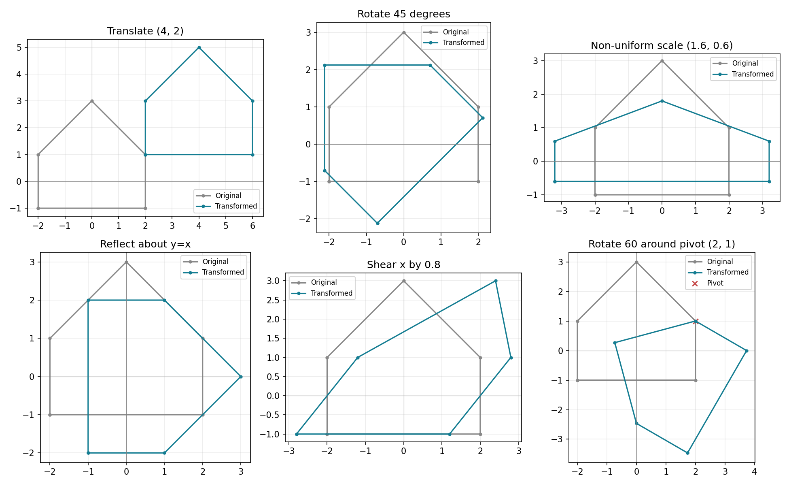
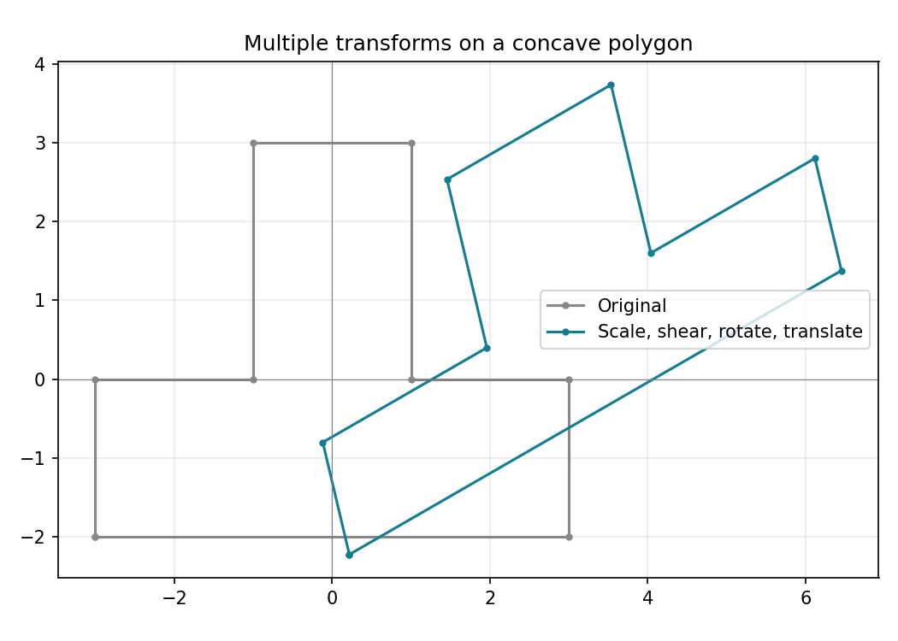
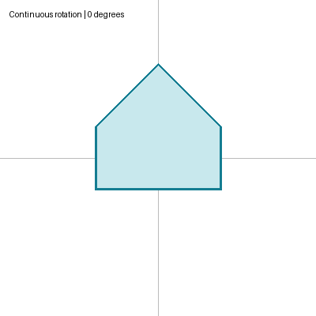

# Lab 3 — 2D homogeneous transformations

Run `python -m lab_03.main` for the complete demonstration, or `python -m lab_03.main --menu` for the interactive terminal menu. The menu accepts parameters, prints matrices and coordinates, and saves `outputs/interactive.png` after each operation. It applies successive choices to the current polygon; choice 6 resets it. `--show` opens the demonstration PNG.

The shared `common/transforms.py` implements translation, rotation, non-uniform scaling, reflection (x, y, origin, y=x), and two-axis shear. All geometry passes through one `apply` function. It computes `M @ [x,y,1]` and divides by the homogeneous coordinate. Column vectors and degrees are used throughout.

For column vectors, translation is `[[1,0,tx],[0,1,ty],[0,0,1]]`, rotation is `[[cos(a),-sin(a),0],[sin(a),cos(a),0],[0,0,1]]`, and scale is `diag(sx,sy,1)`. Shear is `[[1,shx,0],[shy,1,0],[0,0,1]]`. Reflection in y=x swaps x and y. Rotation around pivot P is `T(P) @ R @ T(-P)`.

| Assignment | Coverage |
|---|---|
| 1. Arbitrary pivot rotation | `about(rotation(60), (2,1))`; pivot is invariant in tests |
| 2. Non-uniform scale | `(sx,sy)=(1.6,0.6)` |
| 3. Reflection in y=x | `reflection('y=x')` |
| 4. Menu | `--menu`, all five transform families plus reset |
| 5. Continuous rotation | `outputs/rotation.gif` |
| 6. 2D versus 3D | Comparison below |
| 7. One multiplication function | `apply` for every transformation |
| 8. Complex polygon | Concave polygon; scale → shear → rotate → translate |

## 2D / 3D matrix comparison

| Property | 2D | 3D |
|---|---|---|
| Homogeneous point | `(x,y,1)` | `(x,y,z,1)` |
| Affine matrix | 3×3 | 4×4 |
| Translation location | Last column: tx, ty | Last column: tx, ty, tz |
| Rotation | In the xy plane | About x, y, z or an arbitrary axis |
| Scale | sx, sy | sx, sy, sz |
| Composition | Matrix products; order matters | Same rule with 4×4 products |

## Viva answers (manual 1–15)

1. A geometric transformation maps coordinates to new coordinates.
2. Homogeneous coordinates express translation and linear transforms in a single matrix form.
3. The translation matrix adds tx and ty through its last column.
4. Scaling changes coordinate magnitudes; shearing offsets one coordinate in proportion to another.
5. Reflection mirrors an object across an axis or line.
6. A plain rotation matrix fixes the origin; pivot rotation adds surrounding translations.
7. Translate the pivot to the origin, rotate, and translate back.
8. Matrices offer a uniform representation, composition, and efficient repeated application.
9. In `M3 @ M2 @ M1 @ p`, M1 acts first.
10. A 2×2 linear map fixes zero, so it cannot express a nonzero translation.
11. A proper 2D rotation has determinant +1.
12. Composite transformation combines multiple transforms in one matrix.
13. An affine transformation is a linear transformation followed by translation; it preserves parallelism.
14. Uses include CAD editing, image manipulation, sprites, and map coordinates.
15. 3D introduces z and 4×4 homogeneous matrices; see the comparison table.
