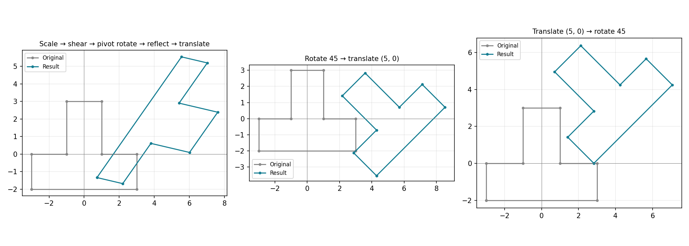
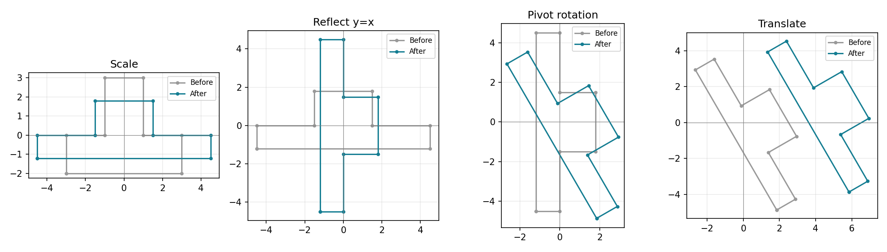
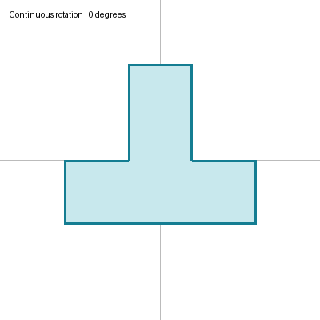

# Lab 4 — Composite transformations

Run `python -m lab_04.main`. Add `--show` to open the comparison image. Use `python -m lab_04.main --menu` for the shared interactive transformation menu (its interactive output is saved in `lab_03/outputs/interactive.png`).

`compose(M1, M2, …)` accepts matrices in the order in which the operations act. With column vectors, it returns `… @ M2 @ M1`. The demonstration combines non-uniform scale, shear, arbitrary-pivot rotation, reflection in y=x, and translation on a concave polygon, and checks the resulting coordinates against sequential application. `outputs/matrices.json` contains every matrix, final vertex, and measured numerical discrepancy.

## Assignment mapping

The manual numbers these 9–16; they duplicate Lab 3 questions 1–8.

| Question | Coverage |
|---|---|
| 9. Arbitrary pivot | `about(rotation(35), (1,1))` in the composite |
| 10. Non-uniform scale | `scaling(1.4, .7)` |
| 11. Reflect y=x | Included as a composite step |
| 12. Interactive menu | `--menu`; cumulative application, parameters and reset |
| 13. Continuous rotation | Local `outputs/rotation.gif` |
| 14. 2D/3D comparison | [Lab 3 comparison](../lab_03/README.md#2d--3d-matrix-comparison) |
| 15. Single multiplication function | All geometry uses shared `apply` |
| 16. Complex polygon | Five operations applied to an eight-vertex concave polygon |

## Viva answers

Manual questions 16–30 repeat Lab 3 questions 1–15 in the same order. The [complete answers](../lab_03/README.md#viva-answers-manual-115) apply directly: subtract 15 from the Lab 4 number to find the answer.

Order matters: rotating `(1,0)` by 90° and then translating by `(2,0)` gives `(2,1)`. Translating first and then rotating gives `(0,3)`. The tests check these independently known results, as well as composition equivalence on 50 seeded points. Floating-point comparisons use a tolerance.
