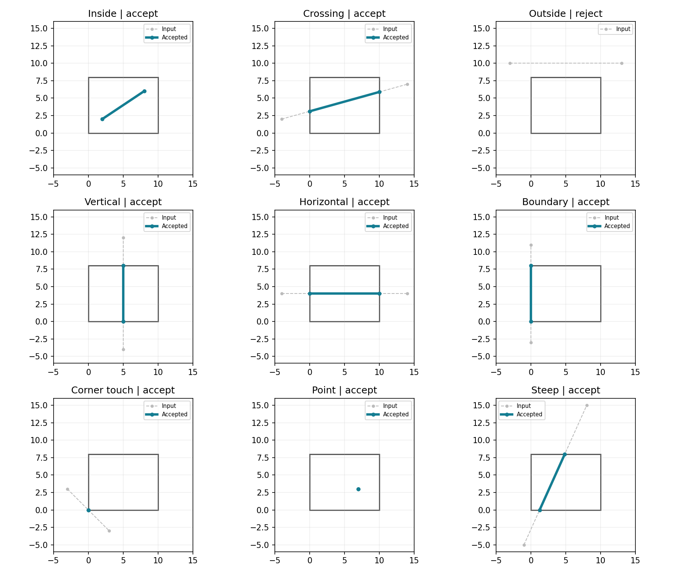

# Lab 5 — Cohen–Sutherland line clipping

Run `python -m lab_05.main` to generate the nine-case demonstration. For custom coordinates:

```bash
python -m lab_05.main --line -4 2 14 7 --rect 0 0 10 8
```

Arguments are x0 y0 x1 y1 and xmin ymin xmax ymax. Results are clipped endpoints as JSON, or `null` for a rejected segment. `--show` opens the demonstration image.

Each endpoint has a four-bit outcode: left=1, right=2, bottom=4, top=8. OR zero accepts the whole remaining segment. A nonzero AND rejects it. Otherwise, intersect one outside endpoint with the indicated boundary, recompute its code, and repeat. Boundary points are inside. Horizontal/vertical lines are handled without division by zero because shared outside bits are rejected before intersection. Nonfinite coordinates and invalid rectangles are rejected.



`outputs/results.json` records inputs, initial outcodes, and accepted endpoints. Cases include inside, crossing, outside, vertical, horizontal, boundary, corner-touching, and zero-length segments. Tests compare 1,000 seeded random segments against an independent parametric-interval clipping implementation.

## Repeated manual questions (included as requested)

The manual repeats transformation assignments 17–24 and viva questions 31–45 under this clipping title. They are retained through explicit mapping rather than replacing the clipping exercise.

| Assignment | Completed exercise |
|---|---|
| 17. Pivot rotation | [Lab 3](../lab_03/README.md), assignment 1 |
| 18. Non-uniform scaling | Lab 3, assignment 2 |
| 19. Reflection y=x | Lab 3, assignment 3 |
| 20. Menu | `python -m lab_03.main --menu` |
| 21. Animation | [Rotation GIF](../lab_03/outputs/rotation.gif) |
| 22. 2D/3D comparison | Lab 3 matrix comparison table |
| 23. Shared matrix multiplication | `common/transforms.py:apply` |
| 24. Complex polygon | [Lab 4](../lab_04/README.md), composite and stage outputs |

For viva questions 31–45, subtract 30 to obtain the corresponding numbered [Lab 3 answer](../lab_03/README.md#viva-answers-manual-115).

## Topic-specific viva preparation

- Clipping restricts geometry to a viewing region; it does not scale the line.
- Outcodes allow trivial accept/reject tests before computing intersections.
- Corner crossings may require more than one boundary intersection.
- A segment touching only a corner returns two identical endpoints at that corner.
- This clips line segments, not filled polygons; polygon clipping needs a different algorithm.
