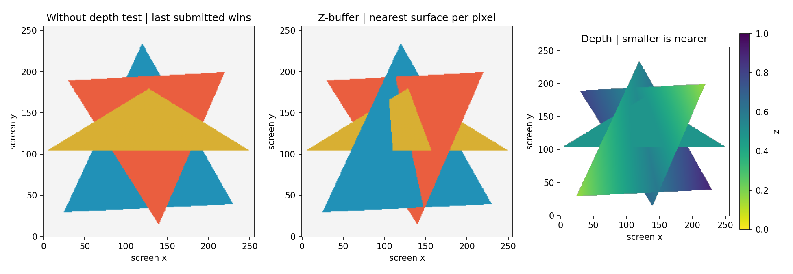

# Lab 6 — Z-buffer hidden-surface removal

Run `python -m lab_06.main` (optionally `--show`). The renderer implements triangle coverage, barycentric depth interpolation, and a depth test in Python/NumPy. It does not use a library's hidden-surface renderer.

Screen coordinates are orthographic, with origin at the lower left. Samples lie at `(x+0.5,y+0.5)`. Depth starts at positive infinity; smaller z means nearer. For each covered sample, interpolate z, compare it with stored depth, and update depth, color, and owner only if nearer. Offscreen bounding boxes are clipped; degenerate triangles are skipped. Either winding is supported.

Three overlapping slanted triangles create regions with different frontmost surfaces. The left panel shows submission-order painting; the middle shows per-pixel depth testing. `outputs/depth.npy` preserves floating-point depth, including infinity for untouched pixels; `object_ids.npy` records triangle ownership. `results.json` reports a probe pixel and checks reversed submission order.

Equal depths retain the first surface, so exact coplanar ties can depend on submission order. Orthographic depth is interpolated linearly; perspective projection and perspective-correct interpolation are outside this lab. The renderer uses an inclusive edge test, not a GPU top-left fill rule. Surfaces are opaque, with no transparency or anti-aliasing. Work is proportional to summed triangle bounding-box areas; buffers require O(width×height) memory.

## Repeated manual questions

The repeated transformation assignments 25–32 and viva 46–60 are included through these mappings.

| Assignment | Completed exercise |
|---|---|
| 25. Pivot rotation | [Lab 3](../lab_03/README.md), assignment 1 |
| 26. Non-uniform scale | Lab 3, assignment 2 |
| 27. Reflection y=x | Lab 3, assignment 3 |
| 28. Menu | `python -m lab_03.main --menu` |
| 29. Rotation animation | [GIF](../lab_03/outputs/rotation.gif) |
| 30. 2D/3D comparison | Lab 3 comparison table |
| 31. Matrix multiplication | `common/transforms.py:apply` |
| 32. Complex polygon | [Lab 4](../lab_04/README.md) |

For viva 46–60 subtract 45 to find the corresponding [Lab 3 answer](../lab_03/README.md#viva-answers-manual-115).

## Topic-specific viva preparation

- Hidden-surface removal selects the nearest visible surface at each sample.
- A Z-buffer stores depth separately from color.
- It resolves intersecting faces without a global polygon sort.
- Z-fighting arises from limited depth precision or nearly coplanar surfaces.
- Transparency requires more than the nearest opaque surface.
