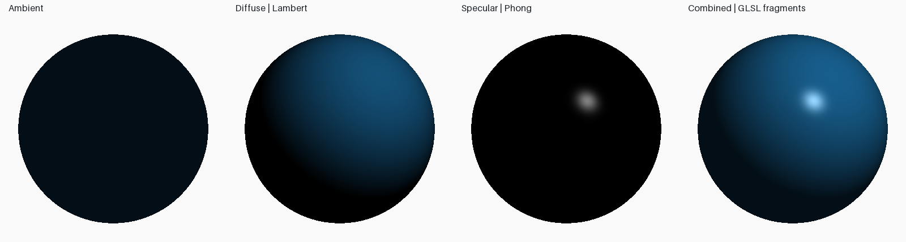
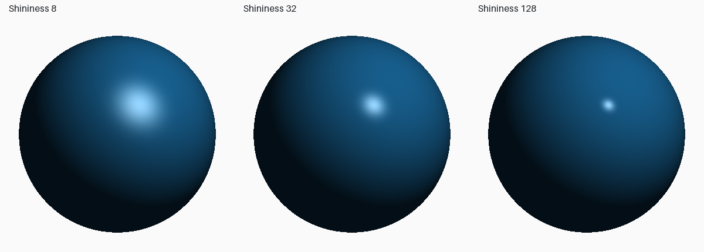
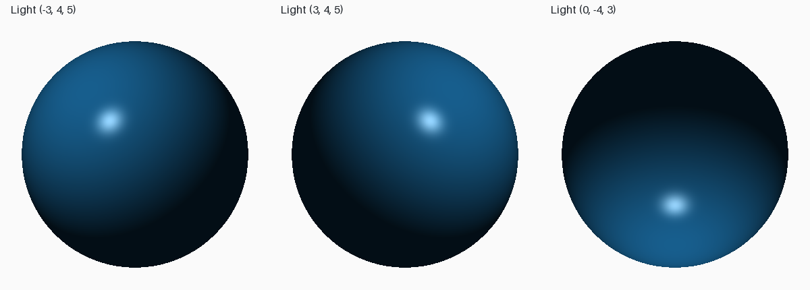

# Lab 7 — Phong illumination of a 3D object

Run `python -m lab_07.main` for real OpenGL windows, or change the light and shininess:

```bash
python -m lab_07.main --light -3 4 5 --shininess 64
```

Close each window to proceed (Escape also exits the active view). Add `--headless` on Linux EGL for export without windows. The object is a real triangle mesh of a unit sphere centered at the origin, using 40 latitude stacks and 80 longitude slices. Vertex normals are analytic sphere normals; the fragment shader interpolates and normalizes them before computing illumination. OpenGL depth testing selects the visible surface under orthographic projection. The eye is `(0,0,5)`.

For normalized normal N, light direction L, and viewing direction V:

- Ambient: `ka * base_rgb` (unit ambient light).
- Diffuse: `kd * base_rgb * max(N·L, 0)` (unit white point-light intensity).
- Reflection direction: `R = 2(N·L)N - L`.
- Specular: `ks * white * max(R·V, 0)^shininess`, set to zero if N·L ≤ 0.
- Final RGB: clamp the sum to [0,1] for display.

`shaders/phong.vert` and `shaders/phong.frag` contain the actual GLSL 1.20 vertex and fragment shaders, compiled and linked by PyOpenGL. The fragment shader performs reflection-vector Phong, not the Blinn half-vector approximation. Directions are normalized per surface point. Negative light contributions are clamped, including specular light from behind the surface. Zero-length vectors and invalid coefficients are rejected.







`outputs/phong_sphere.png` is an actual OpenGL framebuffer capture. Every comparison is rendered with the same GLSL program. `results.json` stores mesh details, coefficients, and CPU reference RGB contributions at the front pole; `opengl.json` records the GL context. The interactive final window animates the light around the sphere. Integration tests compile/link the shaders and compare a real rendered planar sample with a known CPU Phong result, alongside the existing lighting tests.

This is an empirical local illumination model. It omits cast shadows, distance attenuation, indirect illumination, gamma correction, and physically based energy conservation. Values are linear RGB before direct display; no claim of photometric realism is made. The old analytic CPU `sphere` renderer remains only as a numerical test reference; it is not used to produce any delivered scene image. Actual outputs use triangle geometry and GLSL fragment shading.

## Repeated manual questions

The manual repeats transformation assignments 33–40 and viva 61–75 under this illumination title. Both the titled task and the repeated exercises are covered.

| Assignment | Completed exercise |
|---|---|
| 33. Pivot rotation | [Lab 3](../lab_03/README.md), assignment 1 |
| 34. Non-uniform scaling | Lab 3, assignment 2 |
| 35. Reflection y=x | Lab 3, assignment 3 |
| 36. Menu | `python -m lab_03.main --menu` |
| 37. Rotation animation | [GIF](../lab_03/outputs/rotation.gif) |
| 38. 2D/3D comparison | Lab 3 comparison table |
| 39. Matrix multiplication | `common/transforms.py:apply` |
| 40. Complex polygon | [Lab 4](../lab_04/README.md) |

For viva 61–75 subtract 60 to find the corresponding [Lab 3 answer](../lab_03/README.md#viva-answers-manual-115).

## Topic-specific viva preparation

- Ambient approximates background illumination; diffuse models broad matte response; specular models view-dependent highlights.
- Larger shininess produces a narrower highlight.
- Normalization ensures dot products encode cosine angles rather than vector lengths.
- Phong illumination is a lighting model; Phong shading interpolates normals and evaluates lighting per fragment.
- Gouraud shading instead evaluates colors at vertices and interpolates those colors.
