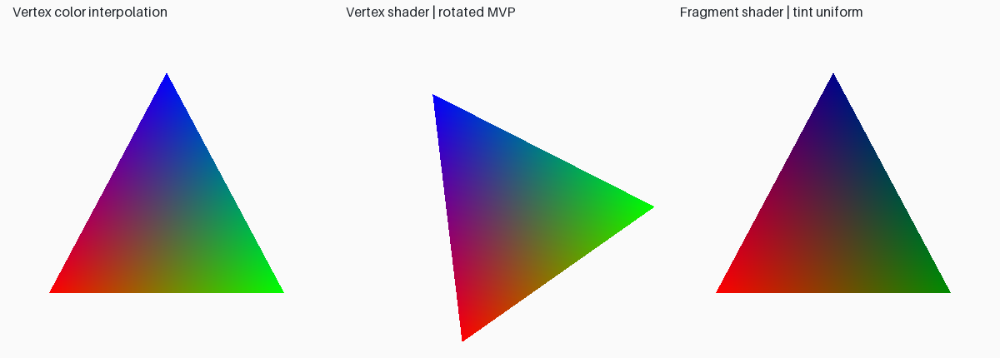
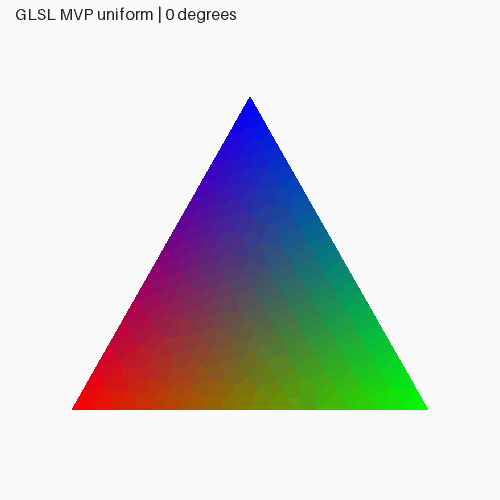

# Lab 8 — OpenGL vertex and fragment shaders

Run `python -m lab_08.main` from the repository root, or `python -m lab_08.main --headless` for Linux EGL export. Close the comparison window to continue to the live rotating triangle. Change parameters with `--angle 45 --tint 1 0.5 0.5`. Escape closes the current view.

`shaders/basic.vert` transforms position attributes with an explicit 4×4 `mvp` uniform and passes vertex colors to a varying. OpenGL interpolates the varying across the triangle. `shaders/basic.frag` multiplies that interpolated color by the `tint` uniform and writes the fragment color. The program compiles and links both shaders, checks required attribute/uniform locations, and uploads interleaved positions/colors into a VBO. It uses `glVertexAttribPointer` and `glDrawArrays`, not fixed-function triangle coloring.

## Pipeline and outputs

1. The VBO stores each vertex as six 32-bit floats: position xyz, color rgb.
2. Attribute offsets are 0 and 12 bytes; the stride is 24 bytes.
3. The vertex shader calculates clip coordinates using column-vector convention.
4. Varying colors are interpolated and processed by the fragment shader.
5. OpenGL rasterizes the result. PNG and GIF frames come from framebuffer readback.

`ShaderMesh` in `main.py` owns the program and VBO, binds attributes/uniforms for each draw, and releases GL resources before context teardown. It is reused by Lab 10 with a 3D MVP and line geometry. Matrices are stored row-major in NumPy and transposed into contiguous column-major storage for `glUniformMatrix4fv(..., transpose=false)`.

`outputs/shader_status.json` records link status, driver log and layout. `results.json` records input vertices, rotation matrix, and tint. `opengl.json` identifies the actual context. The integration test draws into a real GL framebuffer and checks an independently calculated barycentric color at its center, both with and without a tint.

## Repeated manual assignments (41–48)

The manual repeats the transformation exercises under the shader title. Both sets of work are covered:

| Assignment | Completed implementation |
|---|---|
| 41. Rotate about arbitrary pivot | [Lab 3](../lab_03/README.md), assignment 1 |
| 42. Non-uniform scaling | Lab 3, assignment 2 |
| 43. Reflection y=x | Lab 3, assignment 3 |
| 44. Menu-driven transformations | `python -m lab_03.main --menu` |
| 45. Continuous rotation | Local shader animation above; also Lab 3 rotation |
| 46. Compare 2D/3D matrices | Lab 3 comparison table; Lab 10 adds explicit 4×4 viewing matrices |
| 47. One transformation application function | `common/transforms.py:apply` |
| 48. Multiple operations on complex polygon | [Lab 4](../lab_04/README.md) |

## Viva

The manual's questions 76–90 repeat Lab 3 questions 1–15. Subtract 75 to find each corresponding [answer](../lab_03/README.md#viva-answers-manual-115).

For the shader topic: a vertex shader processes vertex attributes and produces clip positions; a fragment shader computes per-fragment outputs. Uniforms remain constant within a draw, attributes vary per vertex, and varyings are interpolated between stages. Compilation validates each stage; linking validates the combined program interface. The compile/link errors propagate to the terminal rather than silently falling back to another renderer. GLSL 1.20 targets the existing compatibility context, not an OpenGL core-profile application.
