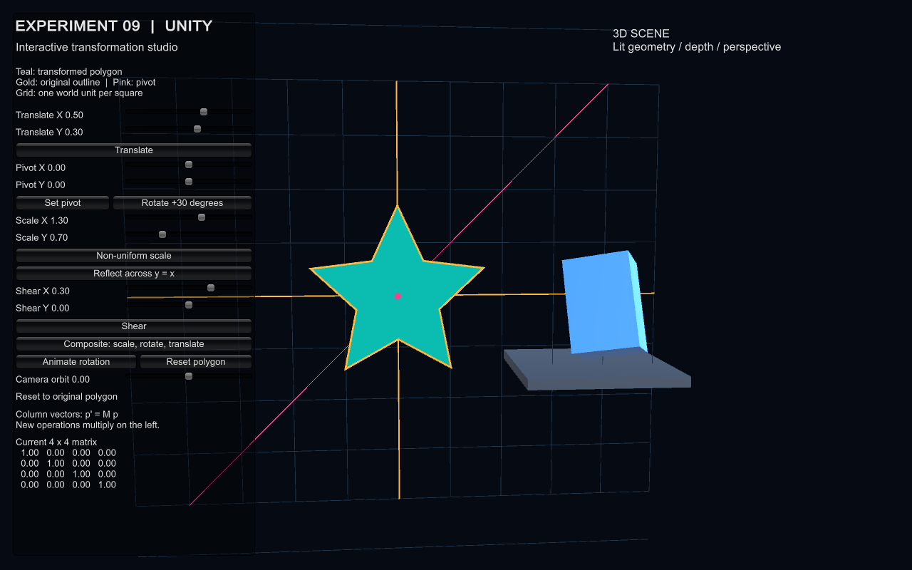
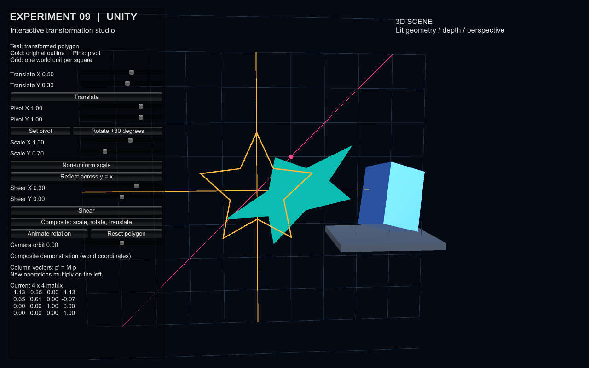
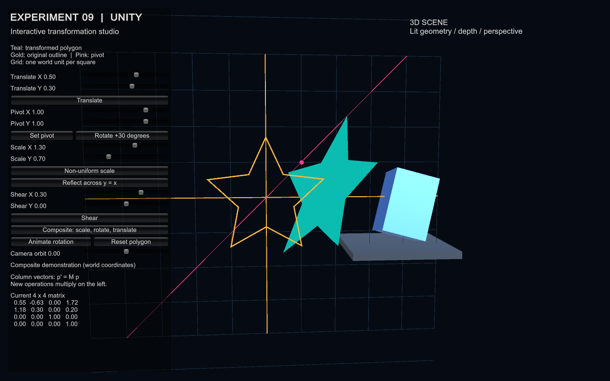

# Experiment 9 - Interactive 3D scene using Unity

This directory is a standalone Unity project. Only Lab 9 is changed. The manual's Unity title is combined with its repeated 2D transformation assignments: these are implemented using explicit homogeneous matrices in Unity C#, rather than an OpenGL substitute. The installed editor is **Unity 6000.6.8f1 (Unity 6)**; compatibility with the manual's Unity 2022 LTS has not been verified.

## Run

- Double-click `Build/Lab09.exe`; keep its accompanying data folder and DLLs together.
- To edit: Unity Hub > Add project from disk > select this `lab_09` folder. Open `Assets/Scenes/InteractiveScene.unity` and press Play.
- To regenerate and build: **Lab 09 > Create scene and build Windows player**. This recreates the demonstration scene, mesh, and materials; save custom edits separately before regenerating.

The scene needs no purchased assets or external models. Unity can resolve its built-in modules on first import. Keep source assets and `.meta` files; editor caches and build products are ignored by the local `.gitignore`.

## Controls and scene

The perspective scene contains a lit rotating 3D cube, stage, coordinate grid, and a filled concave star. Gold marks the original polygon, teal the transformed polygon, and pink the committed pivot and reflection line y=x. Each grid square is one unit.

Set values with the left-panel sliders, then click the action. **Set pivot** commits the pivot sliders; Rotate +30 also commits them. Scaling is about the origin. Reflection exchanges x/y. Composite applies scale, pivot rotation, then translation. Animate/Pause rotates about the committed pivot. Reset restores original polygon coordinates. Camera orbit changes the view. Close the window to exit.

Operations accumulate in world coordinates: `model = operation * model`. The current 4x4 matrix appears in the panel. Repeated large transforms can move the star outside the camera view; Reset restores it. Animation computes its pose from a stored starting matrix to avoid cumulative per-vertex rounding. The independent cube always rotates, demonstrating genuine 3D geometry, lighting, depth, and perspective.

## Assignment coverage (49-56)

| Assignment | Implementation |
|---|---|
| 49. Arbitrary-pivot rotation | Pivot sliders and Rotate +30; `T(p) R T(-p)` fixes the chosen pivot. |
| 50. Non-uniform scaling | Independent X/Y sliders, initially 1.3 and 0.7. |
| 51. Reflection in y=x | Reflect button exchanges x and y. Malformed `y=xy=xy=x` is interpreted as y=x. |
| 52. Interactive menu | Buttons, sliders, current matrix, status, pause and reset. |
| 53. Continuous rotation | Time-based polygon animation and independently rotating 3D cube. |
| 54. 2D/3D matrix comparison | Table and matrices below. |
| 55. Single multiplication function | Every transformed vertex passes through `TransformMath.Apply(matrix, point)`. |
| 56. Complex polygon/composites | Concave ten-point star, triangulated about its interior center; composite `T * R(p) * S`, plus accumulating actions. |

## Matrices

Column vectors are used: `p' = M p`. The rightmost matrix acts first. A 2D homogeneous point `(x,y,1)` is embedded as `(x,y,0,1)` in Unity's 4x4 matrices with z unchanged.

```text
Translation      Rotation          Scale          Shear          Reflection y=x
[1 0 tx]         [cos -sin 0]      [sx 0  0]      [1 hx 0]       [0 1 0]
[0 1 ty]         [sin  cos 0]      [0  sy 0]      [hy 1 0]       [1 0 0]
[0 0  1]         [0     0  1]      [0  0  1]      [0  0 1]       [0 0 1]

Planar affine matrix embedded in 4x4:
[a b 0 tx]
[c d 0 ty]
[0 0 1  0]
[0 0 0  1]
```

| Feature | 2D | 3D |
|---|---|---|
| Cartesian / homogeneous point | (x,y) / (x,y,1) | (x,y,z) / (x,y,z,1) |
| Homogeneous matrix | 3x3 | 4x4 |
| Translation / scaling | Two parameters each | Three parameters each |
| Rotation | One planar angle | Spatial axis and angle, or axis rotations |
| Reflection | Across a line | Across a plane |
| Composition | Matrix multiplication | Same principle with another coordinate |

## Viva answers (91-105)

91. A geometric transformation maps points to new coordinates, changing position, orientation, size, or shape.
92. Homogeneous coordinates let translation and other affine operations use compatible matrices and compose uniformly.
93. Translation has an identity linear part and tx, ty in its last column; it maps (x,y) to (x+tx,y+ty).
94. Scaling multiplies coordinates by factors; shearing adds a multiple of one coordinate to another, slanting a shape.
95. Reflection creates a mirror image across a line or plane and reverses orientation.
96. The basic rotation matrix fixes the origin because it contains no translation. Composed rotations can use other pivots.
97. Translate the pivot to the origin, rotate, then translate back: T(p) R T(-p).
98. Matrices provide a reusable point operation and combine many transformations into one product.
99. With column vectors, the rightmost matrix acts first. Order generally matters: T S differs from S T.
100. A 2x2 linear matrix maps the origin to itself, so it cannot represent a nonzero translation; an extra homogeneous coordinate supplies constant terms.
101. A proper rotation has determinant +1 and preserves signed area or volume.
102. A composite transformation is a product of elementary matrices arranged in the desired application order.
103. An affine transformation is p'=A p+t. It preserves lines, parallelism, and ratios along a line, but need not preserve lengths or angles.
104. Applications include image editing, CAD, animation, map navigation, user interfaces, and robot coordinate frames.
105. 2D uses two spatial coordinates and 3x3 homogeneous matrices. 3D adds depth and uses 4x4 matrices with spatial rotation axes.

## Source and verification

- `Assets/Scripts/TransformMath.cs`: explicit matrices and shared point multiplication.
- `Assets/Scripts/InteractiveScene.cs`: UI, mesh updates, animation, runtime checks, screenshot capture.
- `Assets/Editor/LabBuilder.cs`: reproducible scene creation, ten matrix checks and Windows build.
- `outputs/`: actual build result/log, matrix results, player results, and rendered screenshot when verification succeeds.

Verified on this machine with Unity 6000.6.8f1 and AMD Radeon graphics (Direct3D 11): Windows build **succeeded with 0 errors and 0 warnings**; all **10 matrix checks passed**; player startup, pivot rotation, scaling, reflection, shear, actual mesh update, reset, and time-based polygon/cube animation passed. The player log contains no exceptions. The following are actual player framebuffer captures, visually reviewed for layout and geometry:







Numerical/runtime checks exercise the same operation and mesh-update methods used by the buttons; they do not simulate mouse clicks on every UI control. Visual inspection verifies the rendered menu and scene. Unity 2022 LTS and other platforms were not tested.

Repeat only this lab's build from the repository root (close the project in the editor first):

```powershell
& 'C:/Program Files/Unity/Hub/Editor/6000.6.8f1/Editor/Unity.exe' -batchmode -quit -projectPath "$PWD/lab_09" -executeMethod LabBuilder.Build -buildTarget StandaloneWindows64 -logFile "$PWD/lab_09/outputs/unity-build.log"
```

Run the built player's startup, numerical, mesh-update and reset checks, then capture its actual frame:

```powershell
Start-Process ./lab_09/Build/Lab09.exe -ArgumentList '-lab9-check -screen-fullscreen 0 -screen-width 1280 -screen-height 800' -Wait
```

No other lab demo, test suite, output validator, or run-all script is involved.

Reference: [Unity command-line arguments](https://docs.unity.com/en-us/engine/6000.6/manual/unity-editor/command-line-arguments/editor).
