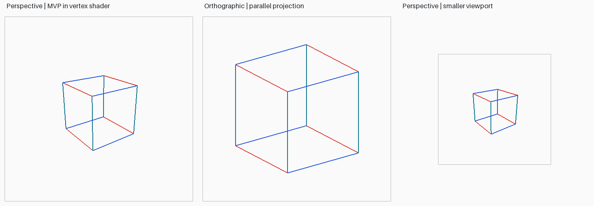
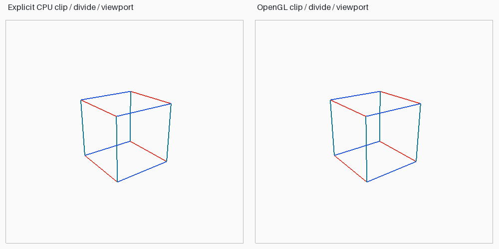
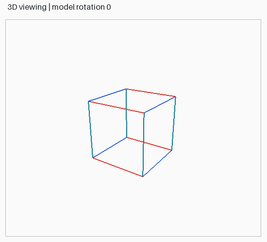

# Lab 10 — 3D viewing pipeline, projection, and viewport mapping

Run `python -m lab_10.main` from the root. Use `--headless` for Linux EGL export, or customize the view:

```bash
python -m lab_10.main --eye 4 3 6 --fovy 50 --angle -20
```

Close each comparison window to proceed to the continuously rotating cube. Escape closes the active window. The cube is a wireframe with all twelve edges visible, so this exercise isolates viewing and projection; hidden-surface removal is demonstrated in Lab 6.

## Implemented stages

The code uses right-handed coordinates and column vectors. The camera looks along negative eye-space Z. `look_at`, `perspective`, `orthographic`, `clip_segment`, and `viewport_map` are explicit Python implementations; no GLU camera/projection helper is used.

| Stage | Calculation | Meaning |
|---|---|---|
| Object → world | `world = model @ object` | Model's 4×4 Y-axis rotation places the cube |
| World → eye | `eye = view @ world` | Orthonormal look-at basis and camera translation |
| Eye → clip | `clip = projection @ eye` | Perspective or orthographic projection |
| Homogeneous clipping | `-w <= x,y,z <= w` | Clip segments before dividing; reject geometry outside the frustum |
| Clip → NDC | `ndc = clip.xyz / clip.w` | Perspective division; visible NDC coordinates lie in [-1,1] |
| NDC → window | `x = vx + (ndc.x+1)*width/2`, similarly for y | Explicit viewport scaling and offset |
| Depth mapping | `depth = (ndc.z+1)/2` | OpenGL default [0,1] window-depth range |

`clip_segment` intersects a line's parameter interval with all six homogeneous clip half-spaces, plus a small positive-w guard to exclude the camera singularity. It handles near-plane/side-plane crossings and fully rejected or behind-camera lines. Perspective division is performed after segment clipping in the CPU drawing path. `stages` also records original vertex values for inspection; unsafe nonpositive-w vertex divisions are left undefined rather than used for rendering.







## Independent OpenGL path

The cube's positions and edge colors are uploaded to the VBO/shader class from Lab 8 and rendered as `GL_LINES`. Its vertex shader computes `gl_Position = projection @ view @ model @ position`. OpenGL then performs homogeneous clipping, perspective division, viewport mapping and rasterization.

The CPU comparison explicitly computes clipping, NDC and window coordinates, then uses OpenGL only to display the resulting 2D segments. The other panel submits the original 3D cube through the vertex shader. Both are real GL framebuffer captures. Red edges follow object x, teal edges object y, and blue edges object z. The viewports preserve aspect ratio; the third panel deliberately maps the same perspective scene into a smaller viewport. Orthographic and perspective views use different viewing extents, so their apparent overall sizes need not match.

`outputs/pipeline_coordinates.csv` records all eight vertices at every stage, including clip w, NDC, screen coordinates, and point visibility. Screen coordinates use a bottom-left origin and continuous pixel-edge coordinates; pixel centers are at `(i+0.5,j+0.5)`. `results.json` includes the matrices, viewport dimensions and three clipping examples (the diagnostic examples use fovy=60°, aspect=1, near=1, far=10, separately recorded in JSON). `opengl.json` records actual context details.

Tests check known camera mappings, near/far plane depths, perspective distance scaling, exact viewport corner mappings, clip crossings/rejections, invalid camera/projection input, and composed matrix equivalence. A real OpenGL test renders the eight cube vertices and verifies colored pixels at their independently predicted window locations. Pixel comparisons allow a small neighborhood for rasterization conventions.

## Repeated manual assignments (57–64)

| Assignment | Completed implementation |
|---|---|
| 57. Arbitrary-pivot polygon rotation | [Lab 3](../lab_03/README.md), assignment 1 |
| 58. Non-uniform scaling | Lab 3, assignment 2 |
| 59. Reflection in y=x | Lab 3, assignment 3 |
| 60. Transformation menu | `python -m lab_03.main --menu` |
| 61. Continuous rotation | Local 3D viewing GIF above and Lab 3 rotation |
| 62. 2D/3D matrix comparison | Lab 3 comparison table and the explicit 4×4 viewing matrices here |
| 63. Shared matrix application | `common/transforms.py:apply`; `stages` applies the 3D pipeline |
| 64. Multiple transforms on a complex polygon | [Lab 4](../lab_04/README.md) |

The manual's questions 106–120 repeat Lab 3 questions 1–15. Subtract 105 to find each corresponding [viva answer](../lab_03/README.md#viva-answers-manual-115).

## Viewing-topic viva preparation

- Perspective causes equal-sized objects farther from the eye to occupy fewer pixels; orthographic projection does not.
- The view matrix represents the inverse camera pose: it maps world coordinates into the camera's frame.
- Clip coordinates have four components; NDC appears after division by w.
- Near must be positive and far greater than near for the implemented perspective convention.
- A viewport maps NDC to a rectangular region of the framebuffer; it does not change the camera or object's world coordinates.
- Clipping before division avoids incorrect connections through or behind the eye. This implementation clips line segments, not filled polygons.
